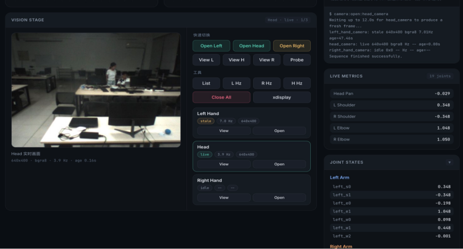
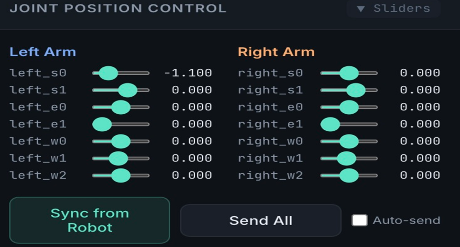
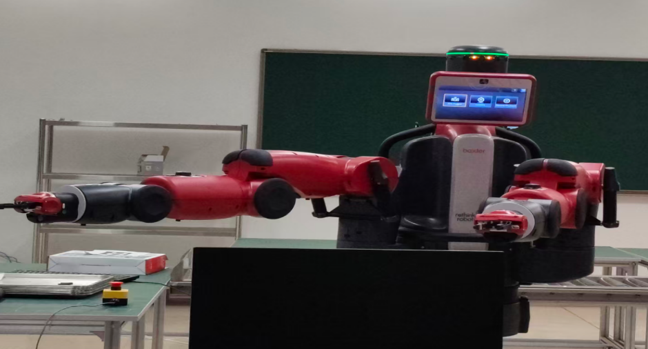

# Baxter 双臂机器人控制系统

> 基于 ROS Noetic 的 Baxter 双臂机器人控制与监控系统：仿真 + 真机全流程，包含双臂姿态控制、头部云台、三路摄像头回传、夹爪控制，以及一套自建的可视化控制界面。

**课程**：自动化综合课程设计 III ｜ 2026-03
**团队**：陈天麟、蔡依婷、李雅汶（三人课程项目，个人贡献见 [CONTRIBUTION.md](CONTRIBUTION.md)）
**技术栈**：Ubuntu 20.04 · ROS Noetic · Gazebo · RViz · Baxter SDK · Python

---

## 界面预览



*自建控制界面：左侧实时视频流，右侧快速切换三路摄像头（Head / Left Hand / Right Hand）、实时帧率与分辨率、19 个关节的实时角度、双臂关节状态。*



*关节位置控制面板：14 个关节的滑杆、`Sync from Robot`（从机器人同步当前角度）、`Send All`、`Auto-send`。*

---

## 真机运行

| | |
|---|---|
|  |  |
| 双臂协同运动 | `open` 姿态 |
|  |  |
| 夹爪抓取 | `bend` 姿态 |

---

## 系统功能

| 模块 | 能力 |
|---|---|
| **双臂关节控制** | 左右臂各 7 个关节（`s0/s1/e0/e1/w0/w1/w2`），位置模式指令下发，20 Hz 控制频率 |
| **预定义姿态** | `home`（垂直下垂）、`open`（展开）、`bend`（内收弯曲）、`cross`（最大内收交叉） |
| **连续动作序列** | `dual_move`：home → open → bend → home；`dual_collab`：home → open → cross → bend → home |
| **头部云台** | 读取 `head_pan` 实时角度，支持左转/右转/点头 |
| **摄像头** | 头部 + 左右手三路，UI 实时显示画面、分辨率与传输帧率 |
| **夹爪** | 左右独立开合、双臂同步开合；仅真机可用（`baxter_interface.Gripper`） |
| **手动控制** | 键盘增量调节关节角度，UI 同步预览目标姿态 |
| **仿真/真机切换** | `./baxter.sh sim` 进入 Gazebo 仿真；`./baxter.sh` 连接真机 |

---

## 系统架构

```
                  ┌──────────────────────────────┐
                  │        UI / 控制逻辑          │
                  │  关节滑杆 · 键盘 · 动作序列   │
                  └──────────────┬───────────────┘
                                 │ JointCommand
                                 ▼
        ┌────────────────────────────────────────────┐
        │  /robot/limb/left/joint_command             │
        │  /robot/limb/right/joint_command            │
        └──────────────────┬─────────────────────────┘
                           ▼
                  ┌─────────────────┐
                  │  Baxter SDK     │
                  │ baxter_interface│
                  └────────┬────────┘
                           │
          ┌────────────────┴────────────────┐
          ▼                                 ▼
   ┌─────────────┐                   ┌─────────────┐
   │  Gazebo     │                   │  真机 Baxter │
   │  (仿真)      │                   │  (ROS 网络)  │
   └─────────────┘                   └─────────────┘

   反馈：/robot/joint_states  →  关节角度、head_pan
        /cameras/*/image      →  三路视频流
```

**核心设计**：同一套控制代码同时支持仿真与真机，差异通过 `baxter.sh` 的环境配置与 `real_robot` 标志隔离。

---

## 关键实现

### 1. 关节指令下发

```python
msg = JointCommand()
msg.mode = JointCommand.POSITION_MODE
msg.names = JOINTS[side]
msg.command = [targets.get(name, self._joint_positions.get(name, 0.0))
               for name in JOINTS[side]]
publisher.publish(msg)
```

缺失的关节目标复用当前角度做容错，避免部分关节被重置到 0。

### 2. 姿态到达判断（仿真 / 真机自适应）

```python
relaxed_max = max(tolerance * 1.8, 0.18)
return max_error <= relaxed_max
```

**真机需要更宽松的误差阈值**——机械间隙、通信延迟、编码器噪声都会导致仿真里能收敛的姿态在真机上反复超时。

### 3. 控制流预热

```python
def prime_control_stream(self, duration=0.20):
    ...
    while not rospy.is_shutdown() and time.time() < deadline:
        self.send_position_command("left", left_targets)
        self.send_position_command("right", right_targets)
        rospy.Rate(60).sleep()
```

真机首次下发指令前，以 60 Hz 连续发送 200 ms 当前位置，填充控制流缓冲，显著改善键盘操作的流畅度。

### 4. 夹爪非阻塞控制

```python
getattr(self._grippers[side], command)(block=False, timeout=2.0)
rospy.sleep(1.0)
```

`block=False` 避免夹爪动作阻塞控制循环，随后短暂延时保证机械到位。

完整代码节选见 [docs/03-code-excerpts.md](docs/03-code-excerpts.md)。

---

## 工程问题与解决

| # | 问题 | 根因 | 解决 |
|---|---|---|---|
| 1 | Ubuntu 内无法下载 SDK（GitHub 与国内镜像均超时） | 虚拟机无外网 | 本地下载后用 FileZilla + SSH 传入 `baxter_ws/src` |
| 2 | 无法与机器人通信 | 本机连的是个人热点，机器人在实验室网络 | 本机切到实验室 Wi-Fi，虚拟机网络改为 **Bridge (Auto)**，确认双方都在 `192.168.3.x` 网段，`ping 011A08P0020.local` 成功 |
| 3 | 能通信但 `enable_robot.py -e` 无响应 | **Gazebo 仿真仍在运行**，`rostopic list` 里全是 `/gazebo/*` 话题 | `killall -9 gzserver gzclient roslaunch rosmaster` |
| 4 | 关闭仿真后仍然一直等待、RViz 报错 | 指导书里让在真机模式下多跑的两条命令，实际会把 ROS Master 拉回仿真 | 重启，**直接** `cd ~/baxter_ws && source ./baxter.sh`（不加 `sim`），再使能 |

> 第 3、4 条是同一个根因的两个表现：**仿真与真机共用同一个 ROS Master**。这是“仿真转真机”最常见的坑。

详见 [docs/04-troubleshooting.md](docs/04-troubleshooting.md)。

---

## 实验结果

| 指标 | 结果 |
|---|---|
| 姿态控制 | `home` / `open` / `bend` / `cross` 四种姿态在真机上稳定复现 |
| 双臂协同 | 连续动作序列执行流畅，左右臂同步性良好 |
| 头部云台 | `head_pan` 角度实时读取，左转/右转响应正常 |
| 摄像头帧率 | 左手 **6.4 Hz**；头部与右手约 2 Hz（受硬件传输限制，偶有卡顿） |
| 夹爪 | 左右独立/同步开合正常，完成抓取小球任务 |
| 仿真 vs 真机 | 仿真响应快、姿态判断严格；真机需放宽误差阈值（机械间隙 + 通信延迟） |

详见 [docs/05-results.md](docs/05-results.md)。

---

## 我的贡献

这是一个 **3 人课程项目**，本人（蔡依婷）承担 **33.33%**：

- **环境搭建**：Ubuntu 20.04 + ROS Noetic + Baxter SDK 的安装与依赖配置
- **Baxter 仿真**：Gazebo 环境启动、模型加载、关节轨迹控制服务
- **自定义动作程序**：四种姿态中 1 个动作的设计与实现
- **系统联调**：仿真/真机切换、通信排查、UI 与控制逻辑的联调

团队分工与完整说明见 [CONTRIBUTION.md](CONTRIBUTION.md)。

---

## 仓库结构

```
.
├── README.md
├── CONTRIBUTION.md          团队分工与个人贡献
├── LICENSE
├── docs/
│   ├── 01-system-setup.md   Ubuntu / ROS / SDK 安装
│   ├── 02-architecture.md   ROS 话题与节点架构
│   ├── 03-code-excerpts.md  5 个核心模块的代码与解读
│   ├── 04-troubleshooting.md 4 类问题的排查过程
│   └── 05-results.md        实验结果与仿真/真机对比
├── src/                     核心模块代码节选
│   ├── joint_commander.py
│   ├── head_state.py
│   ├── dual_arm_motion.py
│   ├── keyboard_control.py
│   └── gripper_control.py
└── images/                  环境配置、UI、真机运行截图
```

---

## 关于代码

⚠️ **本仓库是项目文档与代码节选，不是一个可直接运行的完整 ROS 包。**

- 代码节选来自课程报告，保留了核心逻辑，**省略了 import、日志、部分初始化与 UI 代码**
- 完整工程留在课程工作空间，未随本仓库发布
- 节选的作用是展示控制架构与关键实现，而非提供可复现的构建

---

## 环境

| 项 | 版本 |
|---|---|
| OS | Ubuntu 20.04 LTS |
| ROS | Noetic |
| 仿真 | Gazebo |
| 可视化 | RViz + MoveIt |
| 机器人 | Baxter（SDK Noetic 版，真机序列号 011A08P0020） |
| 语言 | Python 3 |

---

## 许可

本项目文档与代码节选采用 [MIT License](LICENSE)。

Baxter SDK 及相关 ROS 包遵循其原始许可。
