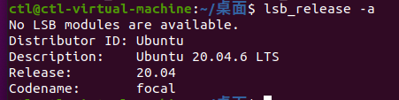
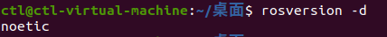
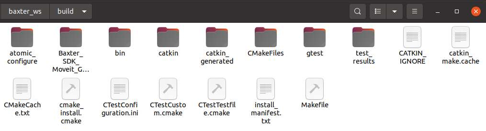
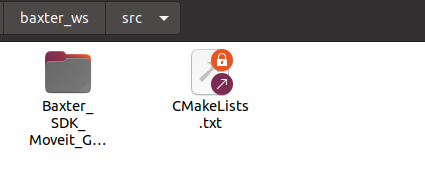
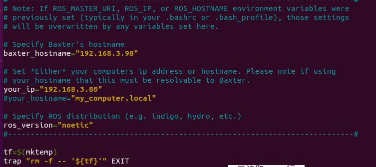
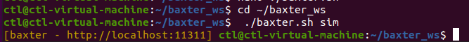
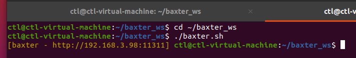

# 系统搭建

> Ubuntu 20.04 + ROS Noetic + Baxter SDK 的完整配置流程。



*图 1｜Ubuntu 20.04 虚拟机*

---

## 1. 安装 ROS Noetic

使用一键安装脚本：

```bash
wget http://fishros.com/install -O fishros && . fishros
```



*图 2｜ROS Noetic 安装*

## 2. 安装依赖

通过 `apt-get` 与 `pip3` 安装必要的 ROS 功能包与工具：

- `rosdep`
- `catkin` 编译工具
- Gazebo 相关包
- MoveIt 相关包
- `baxter_interface` 依赖

## 3. 创建工作空间

```bash
mkdir -p ~/baxter_ws/src
cd ~/baxter_ws
catkin_make
source devel/setup.bash
```



*图 3｜工作空间编译*

把环境变量写入 `~/.bashrc`，避免每次新开终端都要 source。

## 4. 部署 Baxter SDK

下载 Noetic 版本的 SDK，解压到工作空间的 `src/` 下：

```bash
cd ~/baxter_ws/src
# 解压 SDK（或通过 FileZilla + SSH 从本地上传，见 troubleshooting）
cd ~/baxter_ws
rosdep install --from-paths src --ignore-src -r -y
catkin_make
```



*图 4｜SDK 文件*

## 5. 配置 `baxter.sh`

这是**仿真/真机切换的核心**。需要设置两个地址：

| 变量 | 含义 | 示例 |
|---|---|---|
| `baxter_hostname` | 机器人序列号或 IP | `011A08P0020` 或 `192.168.3.16` |
| `your_ip` | 本机 IP | `192.168.3.92` |

```bash
# ~/baxter_ws/baxter.sh
baxter_hostname="011A08P0020"
your_ip="192.168.3.92"
```



*图 5｜baxter.sh 配置*

**前提**：机器人与本机必须在**同一个子网**下。

## 6. 启动仿真

```bash
cd ~/baxter_ws
./baxter.sh sim          # 注意带 sim
roslaunch baxter_gazebo baxter_world.launch
rosrun baxter_interface joint_trajectory_action_server.py
```

出现黄色提示信息说明环境配置成功。



*图 6｜Gazebo 中加载 Baxter*

## 7. 连接真机

```bash
cd ~/baxter_ws
source ./baxter.sh       # 注意：不加 sim
rosrun baxter_tools enable_robot.py -e
```

使能成功会输出 `Enabled` 相关信息。



*图 7｜真机连接成功*

---

## 网络检查清单

```bash
ip a                          # 本机 IP
ping 011A08P0020.local        # 机器人可达性
rostopic list | grep gazebo   # 如果出现大量 /gazebo/* → 当前跑的是仿真
```


*图 8｜与机器人通信成功*

> ⚠️ 如果 `rostopic list` 里出现大量 `/gazebo/*` 话题，说明 ROS Master 仍然指向仿真环境——这是连接真机时最常见的问题，处理方式见 [04-troubleshooting.md](04-troubleshooting.md)。
