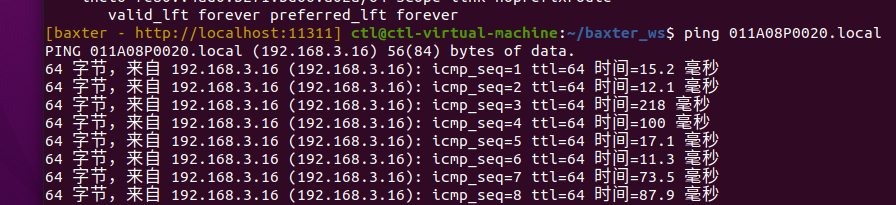
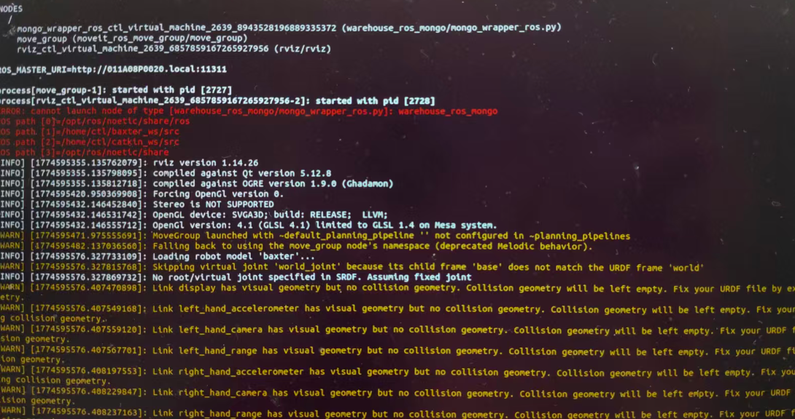

# 问题排查记录

> 仿真转真机过程中遇到的 4 类问题。第 3、4 条其实是同一个根因的两个表现——**仿真与真机共用同一个 ROS Master**。

---

## 问题 1 · Ubuntu 内无法下载 SDK

**现象**

- 通过 GitHub 下载软件包失败
- 换用国内镜像源仍然访问超时

**原因**

虚拟机没有外网访问能力（未配置 VPN / 代理）。

**解决**

绕过网络问题，用文件传输：

1. 在本地（宿主机）下载 Noetic 版本的 SDK
2. 用 **FileZilla Client** 建立与 Ubuntu 的 SSH 连接
3. 上传到 `~/baxter_ws/src`

```bash
# 上传后
cd ~/baxter_ws
rosdep install --from-paths src --ignore-src -r -y
catkin_make
```

---

## 问题 2 · 无法与机器人通信

**现象**

本机与 Baxter 不在同一个局域网，无法通信。

**原因**

本机连的是个人热点，而机器人在实验室网络（411A），**不在同一子网**。

**解决**

1. 把本机 Wi-Fi 切到实验室网络
2. 查看本机 IP：

   ```bash
   ip a
   # 得到 192.168.3.77
   ```

3. 虚拟机网络模式改为 **Bridge (Auto)**
4. 确认虚拟机 IP 也在 `192.168.3.x` 网段
5. 验证连通：

   ```bash
   ping 011A08P0020.local
   ```

6. 反向验证：新终端登录机器人账户（`ruser`），`ping` 本机 IP 也应成功



*与机器人通信成功*

---

## 问题 3 · 能通信，但 `enable_robot.py -e` 无响应

**现象**

```bash
rosrun baxter_tools enable_robot.py -e
```

回车后没有任何输出。

**诊断**

```bash
rostopic list | grep gazebo
```

如果出现**大量 `/gazebo/*` 话题**——说明当前运行的 ROS Master 是 Gazebo 仿真的，不是真机的。

**原因**

之前启动的 Gazebo 仿真环境没有关闭，ROS Master 仍然指向仿真。

**解决**

```bash
killall -9 gzserver gzclient roslaunch rosmaster
```

---

## 问题 4 · 关闭仿真后仍然一直等待，RViz 报错

**现象**

按指导书执行两条命令后，终端一直等待，机器人无法使能：

```
[INFO] ...
（持续等待）
```

RViz 同时报错和 warning。



*RViz 报错*

**原因**

即使杀掉了 Gazebo 进程，**指导书里让在真机模式下额外执行的那两条命令，会把 ROS Master 重新拉回仿真环境**。

所以真实机器人的接口始终连不上。

**解决**

1. 重启 Ubuntu（彻底清理残留的 ROS 进程）
2. 打开**新终端**，直接：

   ```bash
   cd ~/baxter_ws
   source ./baxter.sh        # 注意：不要加 sim
   ```

3. 再执行使能：

   ```bash
   rosrun baxter_tools enable_robot.py -e
   ```

4. 使能成功后再运行动作程序即可

---

## 经验总结

| 教训 | 说明 |
|---|---|
| **一个 ROS Master，两个世界** | 仿真与真机不能同时存在。切换前必须彻底清理 `gzserver/gzclient/rosmaster` |
| **`rostopic list` 是最好的诊断工具** | 看到 `/gazebo/*` 就说明还在仿真 |
| **不要盲信指导书** | 文档里的额外命令可能把环境拉回仿真；以 `baxter.sh` 的实际行为为准 |
| **网络先于控制** | 通信不通时，先确认同网段、桥接模式，再谈使能 |
| **重启是有效的兜底** | 残留进程难以完全清理时，重启比逐个 kill 更可靠 |
