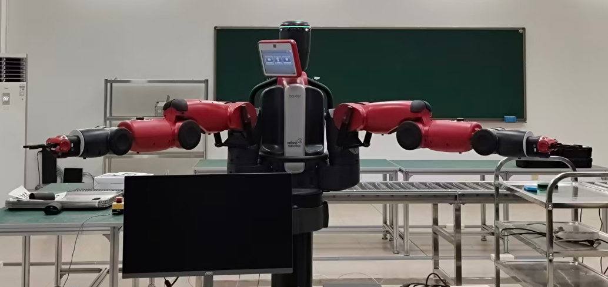
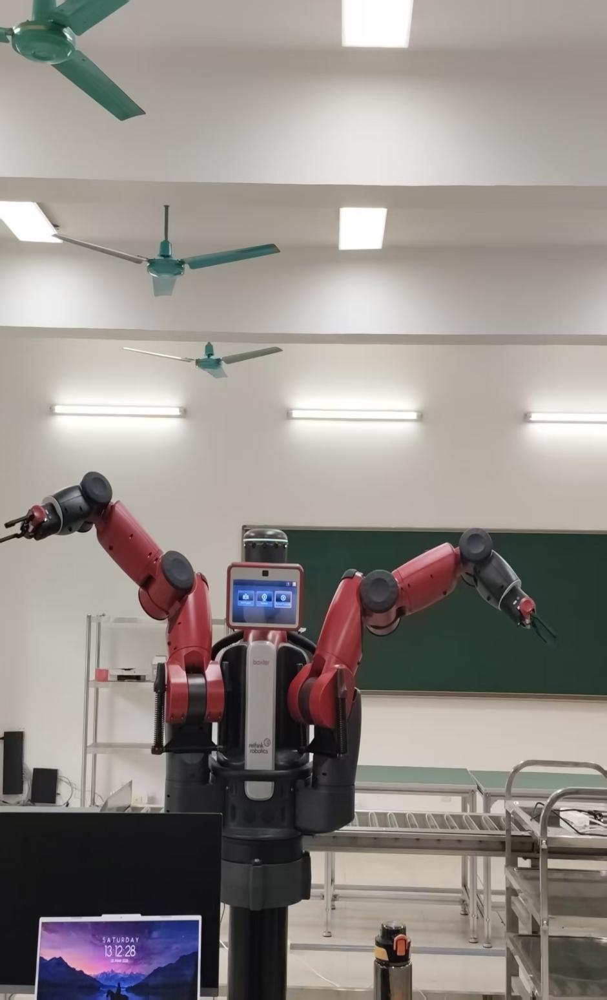
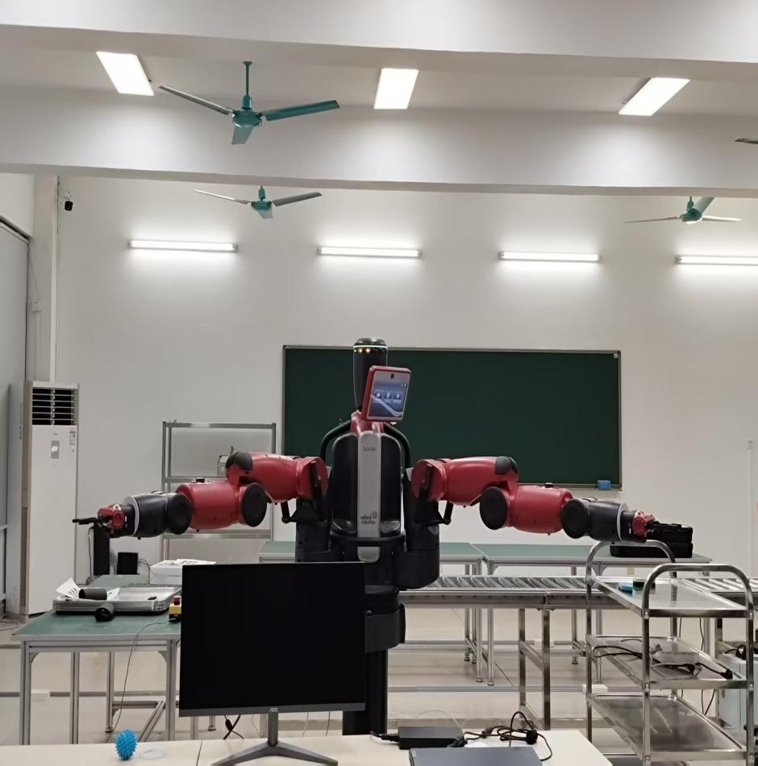
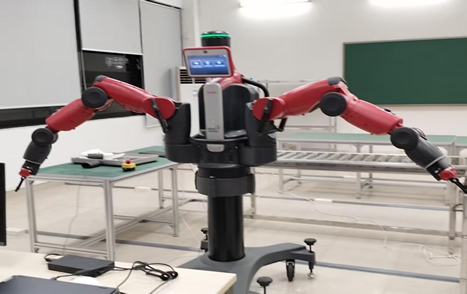
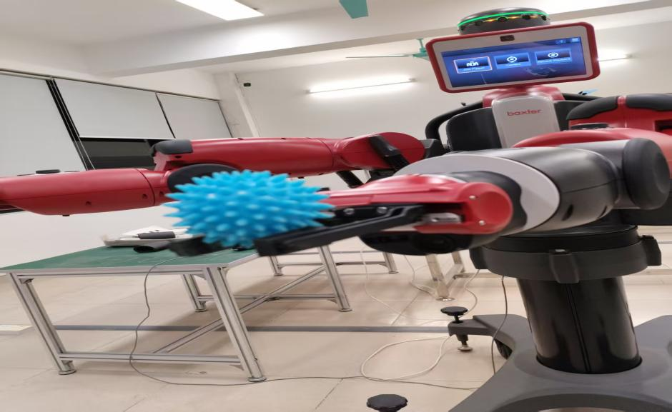

# 实验结果

## 1. 功能验证

| 模块 | 验证内容 | 结果 |
|---|---|---|
| 机械臂 | `home` / `open` / `bend` / `cross` 四种姿态 | ✅ 真机稳定复现 |
| 双臂协同 | `dual_move` / `dual_collab` 连续动作序列 | ✅ 动作流畅，同步性良好 |
| 键盘控制 | 增量调节关节角度 | ✅ 响应正常 |
| 头部云台 | 读取 `head_pan`、左转 / 右转 / 点头 | ✅ 实时读取，动作正常 |
| 摄像头 | 头部 / 左手 / 右手三路开关与回传 | ✅ 三路均可打开并显示 |
| 夹爪 | 左右独立开合、同步开合 | ✅ 完成抓取小球任务 |
| UI | 视频流、关节滑杆、实时角度、动作预览 | ✅ 全部可用 |

## 2. 摄像头帧率

| 摄像头 | 分辨率 | 帧率 | 评价 |
|---|---|---|---|
| 左手 | 640×400 | **6.4 Hz** | 实时性良好 |
| 头部 | 640×400 | ≈ 2 Hz | 偏低，偶有卡顿 |
| 右手 | 640×400 | ≈ 2 Hz | 偏低，偶有卡顿 |

> 帧率差异来自 Baxter 硬件视频传输带宽限制，不是软件问题。

## 3. 姿态执行

| 姿态 | 说明 | 截图 |
|---|---|---|
| `open` | 双臂外展 |  |
| `bend` | 肘部内收弯曲 |  |
| 左转头 | `head_pan` 左旋 |  |
| 右转头 | `head_pan` 右旋 |  |
| 夹取 | 夹爪抓取小球 |  |

## 4. 仿真 vs 真机对比

| 维度 | 仿真（Gazebo） | 真机（Baxter） |
|---|---|---|
| 运动响应 | 快，无通信延迟 | 较慢，存在网络与机械延迟 |
| 姿态判断 | 严格，小误差即可收敛 | 需放宽阈值（×1.8 或 ≥0.18 rad） |
| 摄像头 | 稳定 | 帧率受硬件限制 |
| 夹爪 | 行为不一致 | 可用 |
| 主要问题 | 与真机争抢 ROS Master | 网络配置、使能失败 |

**结论**：同一套控制代码在适当调整误差阈值与预热策略后，可以在仿真与真机上稳定运行，验证了控制方案的可行性。

## 5. 局限

- 未做运动学/动力学层面的轨迹规划，姿态之间为点到点运动
- 未接入视觉闭环（摄像头仅用于监控，未参与控制）
- UI 与控制逻辑为课程实现，未做工程化封装
- 完整代码未随仓库发布，本仓库为文档与节选
